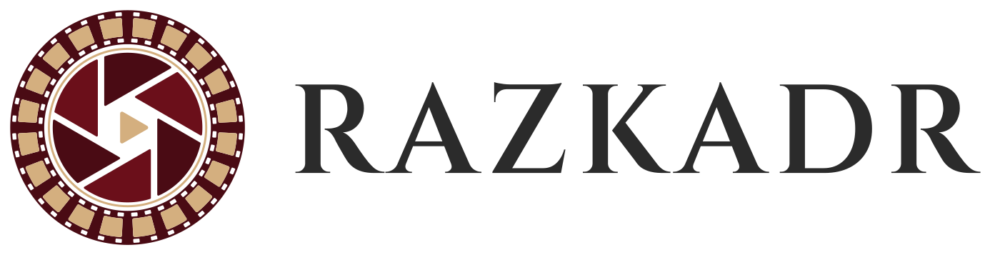

<p align="center"></p>

# Razkadr

**Video in, deck out.** Сервис превращает видео в презентацию с доказательной привязкой к оригиналу: находит качественные кадры по описанию, готовит к каждому короткий текст и собирает слайды (PPTX, PDF, Google Slides) с таймкодами.

Название от «раскадровка»: центральный объект системы — **Storyboard** (JSON), в котором человек может поправить любой кадр и текст до сборки документа.

```
Источник → Индексатор → Отбор → Текст → Раскладка → Рендер/Экспорт
                           ↘        ↓        ↙
                         STORYBOARD (JSON)
```

Первый тестовый сценарий: **видео рецептов** (пресет `recipe`).

## Статус

Этап 0, волна 0 (фундамент). Рабочего кода пока нет, только каркас и план.

## Документы

| Файл | Что это |
|---|---|
| [docs/spec.md](docs/spec.md) | Техническое задание v0.4 |
| [docs/PLAN.md](docs/PLAN.md) | План: волны нарядов и шлюзы приёмки |
| [docs/adr/](docs/adr/) | Архитектурные решения |
| [docs/limitations.md](docs/limitations.md) | Честные границы |
| [docs/naryady/](docs/naryady/) | Наряды (задачи с контрактом) |
| [NARYAD_TEMPLATE.md](NARYAD_TEMPLATE.md) | Шаблон наряда |
| [PROJECT_SCHEME.md](PROJECT_SCHEME.md) | Схема работы над проектом |

## Быстрый старт (разработка)

```bash
python3 -m venv .venv && source .venv/bin/activate
pip install -e ".[dev]"
pytest
```

## Публикация на GitHub

Репозиторий создан локально с историей коммитов. Чтобы опубликовать:

```bash
gh repo create razkadr --private --source=. --remote=origin --push
```

После этого завести issues для нарядов волны 0 из `docs/naryady/` (шаблон `.github/ISSUE_TEMPLATE/naryad.md`).

## Как работаем

Атомарные задачи — **наряды** с контрактом и критериями приёмки; наряды группируются в **волны**, каждая волна заканчивается **шлюзом приёмки** (см. `docs/PLAN.md`). Решения фиксируются в ADR.
